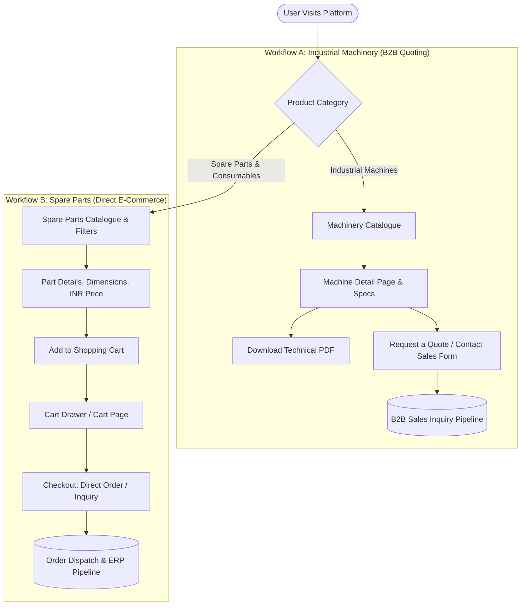

# NAGJAN E-Commerce: Business Requirements & Brand Architecture

**Company:** Mount Kailash Printpack Machines  
**Brand Identity:** NAGJAN  
**Domain Verticals:** Corrugated Packaging Machinery, Industrial Printing Equipment, Spare Parts & Automation  
**Document Status:** Complete Audit & Business Model Specification  

---

## 1. Company Background & Leadership

### 1.1 Organizational Profile
**Mount Kailash Printpack Machines** was established in **May 2010** in Chennai, Tamil Nadu, India, specializing in the import, engineering customization, supply, and servicing of machinery for the corrugated box manufacturing and packaging industry.

- **Proprietor:** Mr. A. Nagarajan, a Business Administration graduate with over two decades of practical expertise in printing, converting, and packaging engineering.
- **Sister Enterprise:** **M/s. Printo Machines and Tools (Regd)**, established in Puducherry and Chennai with over 15 years of industry standing, dealing in Indian printing and packaging machines and acting as the exclusive distributor for Tamil Nadu and Puducherry for **M/s. Associated Engineering Corporation**, Amritsar.
- **Service & Engineering Leadership:** Mr. D. Elumalai, an eminent Indian-born mechanical and electrical engineer leading an in-house team of specialized installation and maintenance engineers.
- **Operational Footprint:** Over **240 corrugators** supplied and installed across India, along with machine exports to international markets.

### 1.2 Facilities & Infrastructure
- **Registered Office:** Plot No. 21, Door No. 14, Third Cross, Thirumalai Nagar, Perungudi, Chennai – 600 096, Tamil Nadu, India.
- **Communication Office:** No. 11, Demonte Avenue, Fourth Cross, Ravi Garden, Thapal Petti, Madhavaram, Chennai – 600 060, Tamil Nadu, India. Phone: 07299 20 7800.
- **Assembly, Customization & Spares Warehouse (Godown):** No. 1, Perumal Koil Street, Near Madhavaram New Bus Depot, Madhavaram, Chennai – 600 060, India.
  - Functions as a dedicated inspection and retrofitting depot where imported machinery frames are overhauled, upgraded with Indian electricals, tested under power, and carefully packaged before dispatch.
  - Maintains permanent stock of critical mechanical and electrical spare parts to guarantee minimum plant downtime for client factories.

---

## 2. Brand Identity: Company vs. Product Brand

A fundamental requirement of the new digital platform is to maintain a clear and professional distinction between corporate entity and product brand:

| Dimension | Corporate Entity | Product / Consumer Brand |
| :--- | :--- | :--- |
| **Name** | **Mount Kailash Printpack Machines** | **NAGJAN** |
| **Role** | The legal company, importer, customizer, distributor, service provider, and warranty guarantor. | The commercial brand affixed to all high-performance machinery, retrofits, and spare parts. |
| **Positioning** | Trustworthy industrial engineering partner with 15+ years of customer service in India. | Heavy-duty, value-for-money, reliable packaging machinery engineered for non-stop plant operation. |
| **Visual Asset** | Corporate footer, legal agreements, official invoices, warranty disclosures. | Prominent header logo (`/logo/nagjan-logo.png`), product badging, equipment nameplates. |

### The "SEMI-INDIAN" Engineering Value Proposition
A key differentiator of NAGJAN machines is the **Semi-Indian machine** concept:
1. **Core Heavy Engineering:** Heavy cast-iron frames (HT250 / Q235A), high-grade alloy steel corrugator rolls (48CrMo / 50CrMo with tungsten carbide or hard chrome plating), precision hydraulic systems, and robust mechanical structures.
2. **Indian Electricals & Global Automation:** Replacing generic electrical parts with globally reputable, locally serviceable components:
   - AC Motors: Crompton Greaves, Siemens, ABB, or Hengshui.
   - Variable Frequency Drives (VFD) & Inverters: Siemens, ABB, Delta, Inovance.
   - Low-voltage Switchgear: Schneider Electric, Chint, Siemens.
   - Pneumatics: AirTac, Yadeke.
3. **Customer Benefits:** 
   - Drastic energy savings (up to 30–40% lower power consumption).
   - High availability of local replacement electrical components anywhere in India.
   - Elimination of extended factory shutdowns caused by imported electronic controller failures.

---

## 3. Target Audience & Customer Profiles

1. **Corrugated Box Factory Owners & MDs:**
   - Looking for complete production lines (e.g. 2PLY plants, automatic corrugators, folder gluers, flexo printers).
   - Priorities: CapEx vs ROI, machine speed, power efficiency, floor space requirements, delivery lead time, and post-sales technical backup.
2. **Plant Managers & Production Heads:**
   - Need reliable technical parameters: roll diameters, flute profiles, cutting precision, steam pressure requirements, and ease of operation.
   - Need fast access to technical specifications and downloadable brochures to present to management.
3. **Maintenance Engineers & Procurement Officers:**
   - Looking for immediate replacement spare parts: anvil covers, slitting blades, grinding wheels, sensors, bearings, cylinders, belts, and valves.
   - Priorities: Part dimensions (OD/ID/thickness), compatibility with existing machinery (Huayu, Xianghai, standard Chinese or Indian corrugators), transparent pricing, and instant dispatch.
4. **International Packaging Companies:**
   - B2B buyers looking for cost-competitive alternative machinery lines with export packaging and proven field reliability.

---

## 4. E-Commerce Dual Business Model

The NAGJAN digital platform must support two distinct, purpose-built business workflows:

### 4.1 Industrial Machinery Workflow (High CapEx)
- **Applicable Products:** 2PLY Corrugated Production Lines, Single Facer Corrugation Machines, Hydraulic Shaftless Mill Roll Stands, Auto Sheet Cutters, Rotary Die Cutters, Flexo Printer-Slotters, Auto Folder Gluers, Lamination Machines.
- **Workflow Mechanics:**
  - Full technical specification tables (speed, width, steam, power, flute geometry).
  - High-resolution machinery photo galleries and component breakdown.
  - Downloadable manufacturer technical PDF brochures.
  - Dedicated **"Request a Quote"** and **"Speak with an Engineer"** modal/forms.
  - **No fixed prices** displayed for complex machinery plants where customization, flute types, working widths, and motor choices alter project costs.

### 4.2 Spare Parts & Accessories Workflow (Direct Transactional)
- **Applicable Products:** Anvil covers (MaxDura), thin blades, female slotting knives, feeder wheels, no-crush wheels, grinding wheels, stitching machine spares, bearings, contactors, pneumatic cylinders, sensors, solenoid valves, and belts.
- **Workflow Mechanics:**
  - Structured categorization and dimension-based search (e.g., OD, ID, thickness, hole count).
  - Transparent pricing in Indian Rupees (INR) as currently proven on `shop.nagjan.com`.
  - Full e-commerce cart management (`/cart`).
  - Checkout flow supporting online order placement and quote-order generation for GST-registered industrial buyers.

---

## 5. Website Functional & Non-Functional Requirements

### 5.1 Functional Requirements
1. **Product Catalog & Dynamic Routing:**
   - Support nested machine and spare parts hierarchies (`/products/[slug]`, `/spare-parts/[slug]`).
   - Filter by machine type, component category, brand, and dimensional attributes.
2. **Quote & Lead Generation Engine:**
   - Multi-step quote request capturing company name, GSTIN (optional), daily production volume, flute requirements, and location.
   - Instant email notifications to `sales@nagjan.com` and customer receipt acknowledgment.
3. **Interactive Specifications Display:**
   - High-density data tables comparing model variants (e.g., 1400mm vs 1600mm vs 1800mm widths).
   - Provenance badges highlighting motor and electrical component brands (Siemens, ABB, Schneider, AirTac).
4. **Shopping Cart & Checkout Support:**
   - Persistent client-side cart (using local storage).
   - Quantity adjustments, subtotal calculations, tax/shipping notes.
   - B2B checkout form requesting billing address, delivery site, and preferred payment mode.

### 5.2 Non-Functional Requirements
- **Performance:** Sub-second page loads, Lighthouse Performance score $\ge 90$.
- **SEO Optimization:** Semantic HTML, OpenGraph tags, structured JSON-LD schemas for B2B industrial machinery and products.
- **Mobile Responsiveness:** 100% fluid layouts across mobile (360px+), tablet, and desktop (1440px+).
- **Accessibility:** Accessible color contrast ratios adhering to WCAG 2.1 AA standards.

