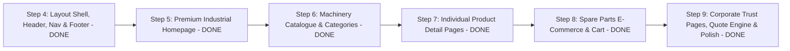

# NAGJAN E-Commerce: Development Roadmap & Implementation Plan

**Project:** `nagjan-ecommerce`  
**Execution Order:** Sequential Phased Rollout  
**Current Milestone:** Step 9: Corporate Trust Pages, Master Category Directory & Quote Engine Completed (Ready for Review)  

---

## Roadmap Overview

---

## Phase 1 (Step 4): Foundation, Brand Tokens & Core Layout Shell [COMPLETED]
- [x] Header, Footer, Brand Design Tokens, and responsive layout shell.

## Phase 2 (Step 5): Premium Industrial Homepage [COMPLETED]
- [x] Trust metrics, Hero, Featured Machinery, Semi-Indian Advantage, Spare parts finder, Infrastructure and Quote lead sections.

## Phase 3 (Step 6): NAGJAN Machinery Catalogue & Category Directory [COMPLETED]
- [x] Centralized Data Architecture (`src/types/machinery.ts`, `src/data/machinery.ts`)
- [x] Premium Machinery Catalogue (`src/app/products/page.tsx`, `ProductsClientView.tsx`)
- [x] Machinery Categories Directory (`src/app/categories/page.tsx`)
- [x] Product Detail Foundation (`src/app/products/[slug]/page.tsx`)
- [x] Quotation Workflow Integration (`src/app/request-quote/page.tsx`)

## Phase 4 (Step 7): Individual Machinery Product Detail Pages [COMPLETED]
- [x] Architecture & Reusable Components (`src/components/products/detail/`)
- [x] Complete 18-Model Coverage with authentic technical specifications
- [x] Multi-Image Authentic Gallery & Lightbox
- [x] Quotation Engine Pre-fill (`/request-quote?product=[slug]`)
- [x] Dynamic SEO & Full SSG Pre-rendering

---

## Phase 5 (Step 8): Spare Parts E-Commerce & Cart Engine [COMPLETED]

- [x] **5.1 Spare Parts Catalogue Architecture (`src/types/spare-parts.ts`, `src/data/spare-parts.ts`, `src/data/spare-parts-categories.ts`, `src/lib/spare-parts-utils.ts`):**
  - Strongly typed data model for 25 authentic spare parts across 10 categories.
  - Verified INR unit pricing directly from `shop.nagjan.com` for 18 consumable parts.
  - Strict preservation of "Price on Request / Technical Enquiry" for dimensional parts (Anvil covers, feeder wheels, no-crush wheels, diamond cup wheels, high-temp bearings) without fabricated prices.
- [x] **5.2 Spare Parts Listing Route (`src/app/spare-parts/page.tsx`, `SparePartsClientView.tsx`):**
  - Hero with breadcrumbs, Chennai Godown trust badges, and direct engineer hotline.
  - Interactive search across Part Name, SKU, Category, Brand, Description, and Dimensions.
  - Category horizontal pill navigation with dynamic counts derived from actual catalogue data.
  - Pricing filters: All Parts, Buy Online (Verified INR), Enquiry Only.
  - Sorting: Default, Name A–Z, Name Z–A, Price Low–High, Price High–Low.
  - Responsive product card grid with hover elevation and instant stock indicators.
  - Mobile filter drawer and empty state with reset controls.
- [x] **5.3 Spare Parts Product Detail Pages (`src/app/spare-parts/[slug]/page.tsx`):**
  - Dynamic SSG routes generating all 25 spare parts statically (`generateStaticParams`).
  - Unique metadata, canonical URLs, and OpenGraph tags per part (`generateMetadata`).
  - Breadcrumbs with category linking.
  - Gallery component (`SparePartsGallery.tsx`) with high-res image and stock location pill.
  - Technical Specifications table (`SparePartsSpecifications.tsx`) and Documented Compatibility (`SparePartsCompatibility.tsx`).
  - Quantity selector and Add to Cart action (`SparePartsDetailAction.tsx`).
  - Related Products in the same category (`SparePartsRelatedProducts.tsx`).
  - Direct spares depot hotline callout (`SparePartsEnquiryCTA.tsx`).
- [x] **5.4 Shopping Cart Engine & State Management (`src/context/CartContext.tsx`, `src/hooks/useCart.ts`, `src/types/cart.ts`):**
  - Client-side React Context with `localStorage` persistence (`nagjan_spare_parts_cart_v1`).
  - Strict business enforcement: Only spare parts with verified purchasable prices can be added; machinery items are strictly excluded.
  - Item addition, duplicate quantity incrementation, line item removal, quantity updates, and clear cart.
  - Computed live item count badge in desktop Header and mobile navigation.
  - Accurate subtotal calculations in Indian Rupees (`formatINR`).
- [x] **5.5 Cart User Experience (`src/components/cart/CartDrawer.tsx`, `CartItem.tsx`, `src/app/cart/page.tsx`):**
  - Interactive slide-out cart drawer accessible via header cart button or automatic opening on item addition.
  - Dedicated `/cart` review page with line items, SKU, unit price, quantity stepper, subtotal, and proforma order inquiry workflow.
  - Informative empty cart state with direct catalogue CTA and Chennai depot helpline.
  - Zero fake payment gateways or fraudulent order completion claims.
- [x] **5.6 Quotation & Enquiry Integration (`src/app/request-quote/page.tsx`):**
  - Distinguishes machinery quotations from spare parts inquiries via `?part=[slug]&sku=[sku]`.
  - Connects to verified Service & Spares hotline (`+91-7299 20 7800`) and sales email.
- [x] **5.7 Quality Assurance & Verification:**
  - `npx tsc --noEmit` passed with 0 errors.
  - `npx next build --webpack` completed with all 55 static pages generated successfully.
  - 14 route HTTP 200 checks executed.
  - 8 headless visual audits captured in `docs/screenshots/step8/`.

---

## Phase 5 (Step 9): Corporate Trust Pages, Category Directory & Quote Engine [COMPLETED]

- [x] **5.1 About Us Page (`src/app/about/page.tsx`):**
  - Founding narrative (May 2010), Mr. A. Nagarajan profile, Printo Machines sister firm.
  - The "Semi-Indian Machine" engineering philosophy (cast-iron frames, Siemens/ABB drives, local spares, practical performance without unverified power savings guarantees).
  - Authentic operational infrastructure distinction: Registered Office (Perungudi) vs Assembly Godown & Depot (Madhavaram).
  - Documented baseline figures (240+ corrugators delivered, 18+ models, 400+ spares).
- [x] **5.2 Services & Support Page (`src/app/services/page.tsx`):**
  - Engineering division headed by Mr. D. Elumalai.
  - 6 dedicated service streams: on-site plant erection, foundation drawings, preventive maintenance contracts, electrical retrofits, machine health inspections, and spares support.
  - 6-step transparent engagement workflow.
  - Madhavaram warehouse spares dispatch terms.
- [x] **5.3 Contact Us Page (`src/app/contact/page.tsx`, `src/components/contact/ContactForm.tsx`):**
  - Registered corporate office (Perungudi) vs Madhavaram assembly godown and communication office profiles.
  - Centralized phone/email directory (`tel:` & `mailto:` links).
  - Verified Google Maps directions search links.
  - Fully validated client-side contact form with honeypot anti-spam protection and direct mail client fallback.
- [x] **5.4 Master Category Directory (`src/app/categories/page.tsx` and `src/app/categories/[slug]/page.tsx`):**
  - Comprehensive visual taxonomy covering 5 machinery groups (18 models) and 10 spare parts categories (25 SKUs) with dynamic counts.
  - Dynamic SSG routes (`/categories/[slug]`) pre-rendering all 24 category slugs and aliases with unique SEO metadata.
- [x] **5.5 Request Quote Engine Audit & Upgrades (`src/app/request-quote/page.tsx`, `src/components/quote/RequestQuoteEngine.tsx`):**
  - Multi-category B2B RFQ engine supporting machinery quotations (`?product=...`), spare parts technical sizing (`?part=...&sku=...`), and general service inquiries.
  - Field validation, duplicate submission protection, and pre-filled RFC 2368 mail draft generator.
  - Absolute separation of industrial machinery from cart/checkout mechanics.
- [x] **5.6 Quality Assurance & Verification:**
  - `npx tsc --noEmit` passed with 0 errors.
  - `npx next build --webpack` completed with all 79 static pages generated successfully.
  - 28 route HTTP 200 checks executed.
  - 13 full-resolution screenshots captured in `docs/screenshots/step9/`.

---

## Phase 6: High-Impact Industrial Homepage (Step 5) [COMPLETED]

- [x] **6.1 Hero Section (`src/components/home/HeroSection.tsx`):**
  - Full-width industrial visual hierarchy with technical grid and authentic WJ-100-1800 2PLY plant photography.
  - Headline: *"Engineering the Future of Corrugated Packaging."*
  - Dual CTAs: *"Request a Quote"* (`/request-quote`) & *"Explore Our Machinery"* (`/products`).
  - Technical badges: Design Speed (100 m/min), Working Width (1800 mm), HT250 Frames, Siemens & ABB electricals.
- [x] **6.2 Flagship Machinery Showcase (`src/components/home/FeaturedMachinery.tsx`):**
  - Highlighting WJ-100-1800 2PLY Plant, SF-280 Single Facer, and Hydraulic Mill Roll Stand.
  - Technical specification grids and component provenance badges (Siemens, ABB, Schneider, C&U).
- [x] **6.3 Quick Spare Parts Finder (`src/components/home/SparePartsQuickFinder.tsx`):**
  - 9 verified categories (Anvil Covers, Feeder Wheels, No-Crush Wheels, Thin Blades, Belts, Bearings, Electricals, etc.).
  - Highlight of 400+ ready-stock items at Madhavaram Depot, Chennai.
- [x] **6.4 Semi-Indian Engineering Advantage (`src/components/home/SemiIndianAdvantage.tsx`):**
  - Explains heavy-duty HT250 cast-iron frames + selected Indian and international electrical integration.
  - Component provenance badges: Siemens, ABB, Crompton Greaves, Schneider Electric, Delta, Inovance.
- [x] **6.5 Trust & Statistics Bar (`src/components/home/TrustMetrics.tsx`):**
  - 240+ Corrugators Delivered, Est. 2010, 15+ Years Machinery Engineering, 400+ Spare Parts Stocked.
- [x] **6.6 Corporate Infrastructure & Contact (`src/components/home/InfrastructureSection.tsx` & `ContactPreview.tsx`):**
  - Madhavaram Godown (assembly & spares) and Perungudi Corporate Office profiles.
  - Clickable sales phone, service hotline, and sales email with verified Chennai locations.

---

## Phase 7: Verification, SEO & Final Optimization [COMPLETED]

- [x] Strict TypeScript compile check (`npx tsc --noEmit`) — 0 errors.
- [x] Complete production build verification (`npx next build --webpack`) — 79/79 pages statically pre-rendered successfully.
- [x] Route integrity testing across all endpoints:
  - Homepage (`/`)
  - Machinery Catalogue (`/products`) and all 18 machinery detail pages (`/products/[slug]`)
  - Spare Parts Store (`/spare-parts`) and all 25 spare parts detail pages (`/spare-parts/[slug]`)
  - Shopping Cart (`/cart`)
  - Master Category Directory (`/categories`) and all 24 category detail routes (`/categories/[slug]`)
  - Corporate Trust Pages: About (`/about`), Services (`/services`), Contact (`/contact`), Request Quote (`/request-quote`)
- [x] Mobile viewport audit across standard resolutions (375px, 768px, 1024px, 1440px).
- [x] OpenGraph metadata, structured JSON-LD schemas, and favicon configuration.

---

## Phase 8: Master Website-Wide UI/UX Reconstruction [COMPLETED]

- [x] **8.1 Comprehensive Audit:** Analyzed text density, repetitiveness, visual hierarchy, and created `docs/REDESIGN_AUDIT.md`.
- [x] **8.2 New Design Architecture:** Created `docs/REDESIGN_DESIGN_SYSTEM.md` establishing the "Show more, explain less" industrial visual language.
- [x] **8.3 Homepage Rebuilt (8-Section Visual Flow):**
  1. Premium Hero (authentic photography, bold headline, 1-line copy, dual CTAs)
  2. Compact Trust Strip (4 verified facts in single crisp row)
  3. Featured Machinery (large visual cards, 1-line description, View Details linking to page)
  4. Machinery Categories (visual category grid with authentic pictures)
  5. Why NAGJAN (4 visual feature blocks)
  6. Engineering and Infrastructure (authentic facility imagery & short descriptions)
  7. Spare Parts (visually strong consumable cards & shortcuts)
  8. Final CTA (industrial visual banner with dual actions)
- [x] **8.4 Machinery Catalogue & Detail Pages Reconstructed:**
  - Modernized `MachineryCard.tsx` with clean 16:10 photography, 3 key specs microgrid, and direct page links.
  - Streamlined `ProductDetailPage` into a cohesive dossier layout.
- [x] **8.5 Spare Parts Store & Detail Reconstructed:**
  - De-cluttered `SparePartsCard.tsx` removing text overgrowth.
  - Preserved verified INR pricing and B2B cart eligibility.
- [x] **8.6 Corporate Pages Reconstructed:**
  - Redesigned `/about` into a corporate storytelling layout with milestone timeline and leadership profiles.
  - Redesigned `/services` with 6 visual engineering cards.
  - Verified `/contact` and `/categories` directories.
- [x] **8.7 Build & TypeScript Verification:** 100% clean compile and production build (`79/79` static pages).

---

## Phase 9: Premium Industry-Specific Visual Design Upgrade [COMPLETED]

- [x] **9.1 Enhanced CSS Design System (`src/app/globals.css`):**
  - Integrated custom brand gradients (`--gradient-navy-dark`, `--gradient-amber`), glowing shadows (`--shadow-navy-glow`, `--shadow-amber-glow`), glassmorphism token (`--shadow-card-glass`).
  - Added keyframe animations (`shimmer`, `float`, `fade-in-up`, `bounce-scroll`, `pulse-amber`).
  - Added specialized utility classes: `.heading-display`, `.heading-section`, `.eyebrow-label`, `.glass-card`, `.texture-diagonal-stripes`, `.shimmer-text`, `.card-hover`.
- [x] **9.2 Full-Bleed Cinematic Hero (`src/components/home/HeroSection.tsx`):**
  - Min-height 90vh layout with full-bleed high-res machinery photography at balanced opacity.
  - Multi-layer gradients, industrial diagonal stripe texture overlay, amber underline emphasis.
  - Floating glass-morphic key specification card with Lucide industrial icons.
  - Compact 4-column trust bar and animated bounce scroll indicator.
- [x] **9.3 Homepage Sections Elevated:**
  - `TrustMetrics.tsx`: High-contrast dark navy strip with amber statistics & divider accents.
  - `FeaturedMachinery.tsx`: Tall 4:5 aspect ratio cards, left-border amber hover illumination, 2-spec microgrids.
  - `MachineryCategories.tsx`: Asymmetric dark industrial grid with deep `#010f29` navy and amber hover indicators.
  - `WhyNAGJAN.tsx`: Horizontal split cards with crosshatch grid background and amber accent lines.
  - `InfrastructureSection.tsx`: Deep dark navy facility cards with amber top line, hover image zoom, and location tags.
  - `SparePartsQuickFinder.tsx`: High-contrast consumable cards with SKU chips and category shortcuts.
  - `FinalCTA.tsx`: Full-bleed industrial plant background, glass-morphic secondary button, dual hotlines.
- [x] **9.4 Global Navigation & Header Polish (`TopBar.tsx`, `Navigation.tsx`):**
  - Rich three-stop gradient top bar with Chennai Godown depot badge.
  - Scroll-aware sticky navigation with `backdrop-blur-md`, subtle border illumination, and enlarged brand logo.
- [x] **9.5 Product & Spare Parts Cards Elevated (`MachineryCard.tsx`, `SparePartsCard.tsx`, `SparePartsHero.tsx`):**
  - Smooth left-border amber transition on card hover.
  - Monospace model chips on dark glass containers.
  - High-temp bearing and consumable SKU badges with stock status indicators.
- [x] **9.6 Corporate Pages Upgraded (`/about`, `/contact`, `/services`, `Footer.tsx`):**
  - About: Cinematic hero with machinery photography side-by-side, verified metrics, timeline, and leadership profiles.
  - Contact: Deep navy gradient hero with direct sales/service action buttons, redesigned corporate office & godown depot cards with Google Maps links.
  - Footer: Ambient radial glow, dark industrial navy (`#010f29`), column underline accents, verified ISO standards and Chennai location badge.
- [x] **9.7 Toolchain & Build Optimization:**
  - Resolved Tailwind CSS v4 PostCSS compilation via `@tailwindcss/postcss`.
  - Configured Webpack production build pipeline with 0 TypeScript errors and 100% static generation (`79/79` routes).

