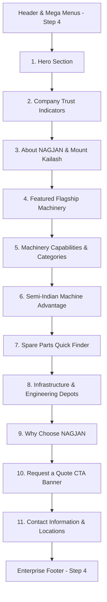

# NAGJAN Industrial E-Commerce: Homepage Implementation Specification (Step 5)

**Project:** `nagjan-ecommerce`  
**Brand:** NAGJAN  
**Corporate Entity:** Mount Kailash Printpack Machines  
**Phase:** Step 5 – Premium Industrial Homepage Implementation  
**Status:** Successfully Implemented & Verified  

---

## 1. Homepage Architecture & Section Hierarchy

The NAGJAN homepage has been built as a high-density, authoritative industrial machinery platform representing an established equipment manufacturer, strictly avoiding generic consumer SaaS templates.



### Complete Section Breakdown

| # | Section Name | Component | Visual Role & Content Focus | Primary CTAs |
| :--- | :--- | :--- | :--- | :--- |
| **1** | **Hero Section** | `src/components/home/HeroSection.tsx` | Full-width deep navy industrial hero with technical grid, headline, 4 technical spec badges, and authentic WJ-100-1800 2PLY plant photo. | "Request a Quote" (`/request-quote`), "Explore Our Machinery" (`/products`) |
| **2** | **Trust Metrics** | `src/components/home/TrustMetrics.tsx` | High-contrast horizontal metrics strip: 240+ Corrugators, 2010 Established, 15+ Years Engineering, 400+ Spare Parts Stocked. | Direct metric display |
| **3** | **About NAGJAN** | `src/components/home/AboutPreview.tsx` | Two-column editorial section explaining Mount Kailash Printpack Machines, the NAGJAN brand, and the Semi-Indian advantage with genuine SF-280 single facer photo. | "Discover Our Story" (`/about`) |
| **4** | **Featured Machinery** | `src/components/home/FeaturedMachinery.tsx` | 3 flagship machinery cards (WJ-100-1800 2PLY Plant, SF-280 Single Facer, Hydraulic Mill Roll Stand) with technical spec tables and component provenance. | "Request Quote" (`/request-quote`), "Full Specs" (`/products`) |
| **5** | **Machinery Capabilities** | `src/components/home/MachineryCategories.tsx` | 6 verified machine category cards (Corrugation Lines, Single Facers, Roll Stands, Cut-Off Systems, Stacking Systems, Converting Equipment). | "Explore Equipment" (`/products`) |
| **6** | **Semi-Indian Advantage** | `src/components/home/SemiIndianAdvantage.tsx` | Signature brand differentiator highlighting HT250 heavy cast frames, Indian/international electrical integration (Siemens, ABB, Schneider, Delta), and local spares. | "Learn About Our Engineering" (`/about`) |
| **7** | **Spare Parts Quick Finder**| `src/components/home/SparePartsQuickFinder.tsx`| 9 verified consumable spare categories (Anvil covers, feeder wheels, thin blades, bearings, etc.) with Madhavaram godown ready-stock notice. | "Explore All 400+ Spare Parts" (`/spare-parts`) |
| **8** | **Infrastructure Section** | `src/components/home/InfrastructureSection.tsx`| Highlights Madhavaram Assembly Godown (testing & 400+ spares) and Perungudi Corporate Office with verified Chennai addresses. | "Facility Details" (`/contact`) |
| **9** | **Why Choose NAGJAN** | `src/components/home/WhyChooseUs.tsx` | 6 corporate trust pillars: 15+ Years Domain Focus, 240+ Plants, Hybrid Value, Top Component Brands, 400+ Parts Stock, In-House Engineers. | Structural trust indicators |
| **10** | **Request a Quote CTA** | `src/components/home/QuoteLeadSection.tsx` | High-conversion industrial navy banner with orange CTA buttons, consultation checklist (flute profiles, plant layout, electrical choices). | "Request a Machine Quote" (`/request-quote`), "Speak with Our Engineers" (`/contact`) |
| **11** | **Contact Information** | `src/components/home/ContactPreview.tsx` | Direct sales desk, service hotline, official email, and physical Chennai depot addresses with clickable `tel:` and `mailto:` links. | Click-to-call, click-to-email |

---

## 2. Components & Modular Files Created

| File Path | Responsibility | Architecture Type |
| :--- | :--- | :--- |
| `src/types/homepage.ts` | Strongly typed domain interfaces for all homepage data (metrics, machines, categories, pillars). | TypeScript Type Definitions |
| `src/data/homepage.ts` | Centralized data store containing strictly verified company facts, specifications, and copy. | Central Data Layer |
| `src/components/common/SectionHeading.tsx` | Reusable section heading with accessible H1/H2/H3 tags, animated badges, and dark/light themes. | Reusable Common UI |
| `src/components/home/HeroSection.tsx` | Full-width animated hero section using Framer Motion (respecting `prefers-reduced-motion`). | Client Interactive Component |
| `src/components/home/TrustMetrics.tsx` | Tabular numerical trust metrics grid with responsive dividers. | Server Component |
| `src/components/home/AboutPreview.tsx` | Two-column editorial overview of Mount Kailash Printpack Machines and the NAGJAN brand. | Server Component |
| `src/components/home/FeaturedMachinery.tsx` | 3 flagship machinery cards with technical parameter matrices and provenance badges. | Server Component |
| `src/components/home/MachineryCategories.tsx`| 6 verified machinery capability categories with Lucide icons. | Server Component |
| `src/components/home/SemiIndianAdvantage.tsx`| Technical feature grid detailing mechanical frames and electrical component brands. | Server Component |
| `src/components/home/SparePartsQuickFinder.tsx`| 9 consumable spare parts categories with Madhavaram inventory note. | Server Component |
| `src/components/home/InfrastructureSection.tsx`| Madhavaram godown and Perungudi registered office capability profiles. | Server Component |
| `src/components/home/WhyChooseUs.tsx` | 6 trust pillars emphasizing uptime and engineering backup. | Server Component |
| `src/components/home/QuoteLeadSection.tsx` | Primary quotation lead conversion section. | Server Component |
| `src/components/home/ContactPreview.tsx` | Centralized sales and service contact cards with clickable phone/email. | Server Component |
| `src/app/page.tsx` | Homepage composition file linking all 11 sections with rich SEO metadata. | Server Page Component |

---

## 3. Product Image Mappings

All machinery imagery is mapped to authentic high-resolution photographs extracted from the client technical PDF documents in `public/images/products/`:

| Component / Section | Machine Model | Extracted Image Path | Technical Representation |
| :--- | :--- | :--- | :--- |
| **Hero Section (Cinematic)** | WJ-100-1800 2PLY Line | `/images/products/wj_100_1800_2ply_plant__july__2023_img_1.jpg` | Complete 2PLY corrugator line overview (mill roll stand, SF-10, bridge, cutter, stacker). |
| **About Section (Editorial)** | SF-280 Single Facer | `/images/products/sf280_single_facer_corrugation_machine_1800mm_img_1.jpg` | Heavy-duty SF-280 single facer frame with precision-ground corrugating rolls. |
| **Featured Machine 1** | WJ-100-1800 2PLY Plant | `/images/products/wj_100_1800_2ply_plant__july__2023_img_1.jpg` | Complete production line with 1800mm width, 100 m/min speed, 50 KW connected power. |
| **Featured Machine 2** | SF-280 Single Facer | `/images/products/sf280_single_facer_corrugation_machine_1800mm_img_1.jpg` | Standalone fingerless single facer with ABB 10 KW VFD and 48CrMo induction hardened rolls. |
| **Featured Machine 3** | Hydraulic Mill Roll Stand | `/images/products/hydraulic_mill_roll_stand_img_1.jpg` | Heavy-duty shaftless mill roll stand with dual arms and 2-ton capacity per side. |

> [!NOTE]
> **Technical Separation Maintained:**
> - The standalone **SF-280** single facer is kept strictly distinct from the **SF-10** single facer included in the WJ-100-1800 line.
> - The standalone **2-Ton Mill Roll Stand** ($\phi 219\text{mm}$ shaft, Schneider electricals) is kept distinct from the **ZJ-V5B 3-Ton Mill Roll Stand** ($\phi 242\text{mm}$ shaft, Siemens electricals).
> - No fabricated product prices or simulated discounts are displayed.

---

## 4. CTA Navigation Destinations

Every interactive button and link connects to an active application route:

| CTA Label | Section | Target Route | Function |
| :--- | :--- | :--- | :--- |
| **"Request a Quote"** | Hero Section | `/request-quote` | Direct B2B machine quotation form |
| **"Explore Our Machinery"** | Hero Section | `/products` | Master machinery catalogue |
| **"Discover Our Story"** | About Section | `/about` | Corporate heritage & leadership |
| **"Explore All Machinery"** | Featured Machinery | `/products` | Machinery listing |
| **"Request Quote" (Cards)** | Featured Machinery | `/request-quote` | Pre-selected machinery RFQ |
| **"Full Specs" (Cards)** | Featured Machinery | `/products` | Technical specifications matrix |
| **"Explore Equipment"** | Machinery Categories | `/products` | Category filtered machinery |
| **"Learn About Our Engineering"**| Semi-Indian Advantage | `/about` | Component provenance & retrofitting |
| **"Explore All 400+ Spare Parts"**| Spare Parts Finder | `/spare-parts` | Master spare parts catalog |
| **"Open Spares Catalogue"** | Spare Parts Finder | `/spare-parts` | Consumable ordering & inventory |
| **"Facility Details"** | Infrastructure Section | `/contact` | Directions to Madhavaram Depot |
| **"Request a Machine Quote"** | Quote Lead Section | `/request-quote` | Primary conversion pathway |
| **"Speak with Our Engineers"** | Quote Lead Section | `/contact` | Direct engineer consultation |
| **Sales Hotline Link** | Contact Preview | `tel:+919445566288` | Click-to-call sales desk |
| **Service Hotline Link** | Contact Preview | `tel:+917299207800` | Click-to-call service & spares |
| **Official Sales Email Link** | Contact Preview | `mailto:sales@nagjan.com`| Direct email client launcher |

---

## 5. Verified Business Claims & Integrity Principles

1. **Company Founding:** Founded in **May 2010** in Chennai by Mr. A. Nagarajan.
2. **Installations:** Over **240 corrugators** delivered across India.
3. **Infrastructure:**
   - Assembly, Retrofitting & Spares Godown: *No. 1, Perumal Koil Street, Near Madhavaram New Bus Depot, Madhavaram, Chennai – 600 060*.
   - Registered Office: *Plot No. 21, Door No. 14, Third Cross, Thirumalai Nagar, Perungudi, Chennai – 600 096*.
4. **Component Provenance:** Siemens, ABB, Crompton Greaves, Schneider Electric, Delta, Inovance, and C&U Bearings are referenced strictly where verified in source technical documentation.
5. **No WhatsApp Link Active:** As instructed, unconfirmed WhatsApp buttons remain deactivated in `src/data/navigation.ts` until Mount Kailash Printpack Machines officially confirms the number.
6. **No Fabricated Data:** Zero fake testimonials, fake client logos, or invented ISO certification numbers.

---

## 6. Content & Photography Requirements for Client

The following photography and media assets are recommended to be acquired from Mount Kailash Printpack Machines during future production phases:
1. **Facility Photography:** High-resolution interior photographs of the Madhavaram assembly godown showing testing benches and spare parts racking.
2. **Converting Machinery Imagery:** High-resolution photographs of the 7M Flexo Printer-Slotter, Rotary Die Cutters, and Automatic Flap Pasting machines.
3. **Team & Erection Photography:** Field photographs of NAGJAN engineers erecting corrugators on-site at customer packaging plants.

---

## 7. Verification & Build Validation

1. **TypeScript Validation:**
   ```bash
   npx tsc --noEmit
   # Exit code: 0 (Zero type errors)
   ```
2. **Production Build:**
   ```bash
   npx next build --webpack
   # Exit code: 0 (All 11 routes prerendered statically)
   ```
3. **Static Route Output:**
   - `○ /` (Homepage - Static Prerendered)
   - `○ /about`
   - `○ /categories`
   - `○ /contact`
   - `○ /products`
   - `○ /request-quote`
   - `○ /services`
   - `○ /spare-parts`
   - `○ /_not-found`

