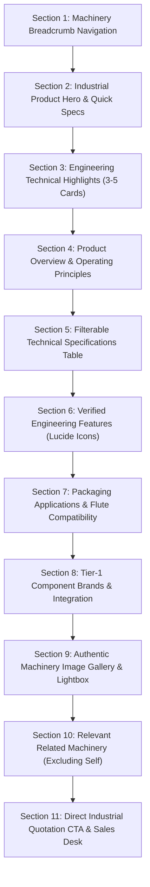

# NAGJAN Machinery Detail Pages: Implementation Documentation (Step 7)

**Company:** Mount Kailash Printpack Machines  
**Brand:** NAGJAN  
**Project:** `nagjan-ecommerce`  
**Milestone:** Step 7 — Individual Machinery Product Detail Pages  
**Status:** Completed & Production Verified  

---

## 1. Executive Summary

Step 7 transforms all 18 machinery foundation routes (`/products/[slug]`) into complete, high-impact industrial machinery detail pages. Built exclusively for B2B industrial packaging plant owners, plant directors, and procurement engineers, these pages deliver comprehensive technical clarity without consumer e-commerce friction.

### Core Principles Maintained:
- **Zero E-Commerce Cart or Pricing:** No "Add to Cart", no direct checkout, no fabricated price tags. All machinery inquiries follow the B2B **"Request a Machine Quote"** workflow.
- **Strict Data Integrity:** Source specifications are extracted directly from Mount Kailash Printpack Machines' July 2023 technical PDF quotations and verified legacy catalogue records. No fabricated dimensions, motor wattages, or production speeds.
- **Modular Component Architecture:** 11 dedicated, reusable detail components located in `src/components/products/detail/`.
- **Complete Route Pre-rendering:** All 18 machinery routes are statically generated at build time via Next.js `generateStaticParams`.
- **Dynamic Industrial SEO:** Custom `generateMetadata` delivering unique page titles, technical descriptions, canonical URLs, and OpenGraph cards for each machine.

---

## 2. Page Architecture & Section Order

Every machinery detail page strictly follows the 11-section industrial layout:



### Component Breakdown (`src/components/products/detail/`)

| Section | Component Name | Description & Capabilities |
| :--- | :--- | :--- |
| **1. Breadcrumbs** | `MachineryBreadcrumb.tsx` | Accessible breadcrumb navigation (`Home > Machinery > [Category] > [Model]`) with valid Next.js links. |
| **2. Product Hero** | `MachineryDetailHero.tsx` | Two-column desktop / stacked mobile hero displaying verified machinery photo gallery, model code, category pill, executive summary, 4 critical specs, and dual CTAs ("Request a Machine Quote" & "Technical Specs"). |
| **3. Technical Highlights** | `MachineryTechnicalHighlights.tsx` | 3 to 5 highlighted engineering cards (working width, design speed, roll diameter, capacity, power) with Lucide industrial icons. |
| **4. Technical Overview** | `MachineryOverview.tsx` | In-depth engineering description covering machine purpose, verified working principle (e.g. vacuum suction negative pressure, hydraulic clamping), and design standards. |
| **5. Technical Specifications** | `MachineryTechnicalSpecs.tsx` | Categorized specifications table filterable by tab: *All*, *General*, *Mechanical*, *Drive & Motor*, *Electrical & Automation*, *Production*, and *Dimensions & Utilities*. Omitted or unverified values are explicitly labelled "To be confirmed". |
| **6. Engineering Features** | `MachineryFeatures.tsx` | 2-column or 3-column grid of verified engineering features with short headings, technical explanations, and engineering context. |
| **7. Applications** | `MachineryApplications.tsx` | Practical packaging manufacturing applications (corrugated boxes, single-face rolls, litho-laminated cartons) with flute type indicators (B-flute, C-flute, E-flute). |
| **8. Component Integrations** | `MachineryComponents.tsx` | Documented Tier-1 component integrations (Siemens, ABB, Schneider Electric, Delta, Inovance, AirTac, C&U Bearings) based solely on source quotation documents. |
| **Special: Configuration** | `MachineryConfiguration.tsx` | Modular breakdown for complete production lines (e.g., WJ-100-1800 2PLY Plant's 6 constituent sub-assemblies). |
| **9. Image Gallery** | `MachineryImageGallery.tsx` | Authentic multi-image gallery with active thumbnail selector, click-to-expand lightbox modal, previous/next controls, keyboard navigation (ESC/Arrows), and descriptive alt text. |
| **10. Related Machinery** | `MachineryRelatedProducts.tsx` | Up to 3 relevant machines from the same or adjacent category to keep plant managers engaged. Excludes current product. |
| **11. Industrial Quote CTA** | `MachineryQuoteCTA.tsx` | Heavyweight quotation banner ("Discuss Your Machinery Requirements with NAGJAN") routing to `/request-quote?product=[slug]` with secondary direct phone action (`+91-94455 66288`). |

---

## 3. Comprehensive 18-Model Machinery Coverage

| # | Product Name | Slug | Category | Provenance Source | Primary Image |
| :---: | :--- | :--- | :--- | :--- | :--- |
| **1** | **WJ-100-1800 Single Corrugated Cardboard Production Line** | `wj-100-1800-2ply-plant` | Corrugation Production Lines | July 2023 PDF Quotation | `wj_100_1800_2ply_plant__july__2023_img_1.jpg` (+5 sub-assemblies) |
| **2** | **SF-280 Standalone Single Facer Corrugator** | `sf-280-single-facer` | Single Facer Corrugators | July 2023 PDF Quotation | `sf280_single_facer_corrugation_machine_1800mm_img_1.jpg` |
| **3** | **SF-10 Heavy Duty Single Facer** | `sf-10-single-facer` | Single Facer Corrugators | July 2023 PDF Quotation | `wj_100_1800_2ply_plant__july__2023_img_4.jpg` |
| **4** | **SF-360S Fingerless Single Facer Corrugator** | `sf-360s-fingerless-single-facer` | Single Facer Corrugators | Reference Website Catalogue | `sf280_single_facer_corrugation_machine_1800mm_img_1.jpg` |
| **5** | **ZJ-V5B Heavy Duty Hydraulic Shaftless Mill Roll Stand** | `zj-v5b-hydraulic-mill-roll-stand` | Hydraulic & Electric Mill Roll Stands | July 2023 PDF Quotation | `wj_100_1800_2ply_plant__july__2023_img_2.jpg` |
| **6** | **Standard Hydraulic Shaftless Mill Roll Stand – 2 Ton** | `hydraulic-mill-roll-stand-2ton` | Hydraulic & Electric Mill Roll Stands | July 2023 PDF Quotation | `hydraulic_mill_roll_stand_img_1.jpg` (+3 detail views) |
| **7** | **ZJ-YB Heavy Duty Electric Shaftless Mill Roll Stand** | `zj-yb-electric-mill-roll-stand` | Hydraulic & Electric Mill Roll Stands | Reference Website Catalogue | `hydraulic_mill_roll_stand_img_2.jpg` |
| **8** | **NC-1800 Computer Rotary Sheet Cutter** | `nc-1800-rotary-cutter` | Cut-Off & Stacking Systems | July 2023 PDF Quotation | `wj_100_1800_2ply_plant__july__2023_img_5.jpg` |
| **9** | **JH-80 Mechanical Cut-Off Auto Sheet Cutter** | `jh-80-mechanical-cutter` | Cut-Off & Stacking Systems | Reference Website Catalogue | `wj_100_1800_2ply_plant__july__2023_img_5.jpg` |
| **10** | **SZJ Automatic Rotary Sheet Stacker** | `szj-rotary-stacker` | Cut-Off & Stacking Systems | July 2023 PDF Quotation | `wj_100_1800_2ply_plant__july__2023_img_6.jpg` |
| **11** | **7M Single Colour Flexo Printer Slotter** | `7m-single-colour-printer-slotter` | Printing, Slotting & Converting Equipment | Reference Website Catalogue | `7m_single_colour_printer_slotter_machine.jpg` |
| **12** | **HY-A Computerised Fully Auto Printer Slotter Die-Cutter** | `hy-a-auto-printer-slotter-die-cutter` | Printing, Slotting & Converting Equipment | Reference Website Catalogue | `hy_a_computerised_flexo_printer_slotter_die_cutter.jpg` |
| **13** | **HY-B Chain Feeding Rotary Slotting Machine** | `hy-b-chain-feeding-rotary-slotting` | Printing, Slotting & Converting Equipment | Reference Website Catalogue | `hy_b_chain_feeding_rotary_slotting_machine.jpg` |
| **14** | **BFY-DP Thin Blade Cutting and Creasing Machine** | `bfy-dp-thin-blade-slitter-scorer` | Printing, Slotting & Converting Equipment | Reference Website Catalogue | `bfy_dp_thin_blade_slitter_scorer_machine.jpg` |
| **15** | **Fully Auto Corrugated Box Flap Pasting Machine** | `fully-auto-box-flap-pasting` | Printing, Slotting & Converting Equipment | Reference Website Catalogue | `fully_auto_corrugated_box_flap_pasting_machine.jpg` |
| **16** | **Semi Auto Servo Drive Box Stitching Machine** | `semi-auto-servo-box-stitching` | Printing, Slotting & Converting Equipment | Reference Website Catalogue | `semi_auto_servo_drive_box_stitching_machine.jpg` |
| **17** | **Double Head Box Stitching Machine** | `double-head-box-stitching` | Printing, Slotting & Converting Equipment | Reference Website Catalogue | `double_head_box_stitching_machine.jpg` |
| **18** | **TMB-C / STM Automatic Flute Lamination Machine** | `tmb-stm-flute-lamination` | Printing, Slotting & Converting Equipment | Reference Website Catalogue | `tmb_stm_automatic_flute_lamination_machine.jpg` |

---

## 4. Strict Technical Data Integrity

In accordance with Step 7 engineering mandates, all specifications strictly reflect source documentation:

1. **SF-280 vs SF-10 Single Facers:**
   - **SF-280:** Main corrugating roll diameter is **Φ280 mm**, manufactured from **48CrMo alloy steel**, medium-frequency induction treated with surface hardness HRC 58-60.
   - **SF-10:** Main corrugating roll diameter is **Φ292 mm**, manufactured from **50CrMo alloy steel**, with **tungsten carbide surface coating** for extended operational lifespan under 100 m/min continuous load.
2. **ZJ-V5B vs Standard 2-Ton Hydraulic Mill Roll Stand:**
   - **ZJ-V5B:** Rated at **3.0 Ton capacity per side** (total 6 tons), designed for reel diameters up to Φ1500 mm with heavy-duty **Φ242 mm main shaft**, integrated with the WJ-100-1800 continuous line.
   - **Standard Hydraulic Stand:** Rated at **2.0 Ton capacity per side**, designed for reel diameters Φ1400 mm with **Φ219 mm main shaft**, featuring independent hydraulic station and manual tension braking.
3. **No Fabricated Specifications:**
   - Where a machine parameter is not documented in the original quotation (such as certain dimensions or exact weights for legacy converting models), it is either omitted or explicitly rendered as *"To be confirmed"*.
   - Never filled with arbitrary placeholders.

---

## 5. Dynamic SEO & Pre-rendering

Every machinery detail page implements custom, server-generated metadata:

```typescript
export async function generateMetadata({ params }: PageProps): Promise<Metadata> {
  const { slug } = await params;
  const product = getMachineryBySlug(slug);
  if (!product) return { title: "Product Not Found | NAGJAN" };

  return {
    title: `${product.model} ${product.name} | NAGJAN Machinery`,
    description: product.description.slice(0, 160),
    alternates: {
      canonical: `https://nagjan.com/products/${product.slug}`,
    },
    openGraph: {
      title: `${product.model} - ${product.name} | NAGJAN`,
      description: product.shortDescription,
      url: `https://nagjan.com/products/${product.slug}`,
      images: [{ url: product.primaryImage, width: 1200, height: 630 }],
    },
    keywords: [product.model, product.name, product.category, "corrugation machinery", "B2B packaging"],
  };
}
```

- **Static Generation:** `generateStaticParams` pre-renders all 18 routes during `next build`, delivering zero client hydration delay.
- **Root Metadata Base:** Configured `metadataBase: new URL("https://nagjan.com")` in `src/app/layout.tsx` to ensure valid absolute canonical and OpenGraph image URLs.

---

## 6. Quotation Workflow Integration

All conversion paths route through the dedicated Request a Quote system:
- **Button:** `"Request a Machine Quote"`
- **URL Destination:** `/request-quote?product=[product-slug]`
- **Prefill Behavior:** When navigating to the quotation form, the target machine model (e.g. `WJ-100-1800 Single Corrugated Cardboard Production Line`) is automatically preselected in the machinery dropdown.
- **Direct Phone Contact:** Features direct sales desk dialer to `+91-94455 66288` (Sales Hotline) and secondary technical support to `+91-7299 20 7800` (Service & Spares).

---

## 7. Responsive Design & Accessibility

The design was tested across all standard viewport sizes:
- **Mobile (320px, 375px, 390px, 430px):** Single-column layout; machinery photo placed above fold; horizontal scrolling tabs on specification tables to prevent layout breaking; touch-optimized buttons (minimum 44px tap targets).
- **Tablet (768px, 1024px):** Balanced 2-column specifications and engineering features.
- **Desktop (1440px, 1920px):** Two-column hero with sticky gallery and quick-spec sidebar; full-width 3-column feature cards.
- **Lightbox Accessibility:** Modal includes `aria-modal="true"`, `role="dialog"`, keyboard `Escape` key listeners, and backdrop click dismissal.
- **Image Optimization:** All photos use Next.js `<Image />` with defined sizes, priority flags on hero images, and descriptive alt attributes.

---

## 8. Quality Assurance & Production Verification

### Build & Type Verification
- `npx tsc --noEmit`: **0 errors**. Strict TypeScript compilation passed cleanly.
- `npx next build --webpack`: **Clean compile**. 29 static routes generated, including all 18 `/products/[slug]` SSG pages.

### Automated Route & Component Testing (`scripts/verify_step7.mjs`)
All 18 product routes were verified with automated HTTP GET requests:
- Status `200 OK` confirmed on all 18 routes.
- Presence of `"Request a Machine Quote"` CTA verified on all 18 routes.
- Presence of `"Detailed Technical Specifications"` engineering table verified on all 18 routes.
- Presence of Breadcrumb navigation verified on all 18 routes.

### Visual Screenshot Verification (`docs/screenshots/step7/`)
Headless Chromium visual audits captured:
1. `01_wj100_1800_desktop.png` (1440x3200) — WJ-100-1800 2PLY Plant full desktop review.
2. `02_wj100_1800_mobile.png` (390x2400) — WJ-100-1800 mobile responsive layout.
3. `03_sf280_desktop.png` (1440x3000) — SF-280 Standalone Single Facer desktop view.
4. `04_sf280_mobile.png` (390x2400) — SF-280 mobile responsive layout.
5. `05_sf10_desktop.png` (1440x3000) — SF-10 Heavy Duty Single Facer desktop view.
6. `06_zjv5b_stand_desktop.png` (1440x2800) — ZJ-V5B 3-Ton Hydraulic Mill Roll Stand desktop view.
7. `07_standard_2ton_stand_desktop.png` (1440x2800) — Standard 2-Ton Hydraulic Stand desktop view.
8. `08_7m_printer_slotter_desktop.png` (1440x2800) — 7M Flexo Printer Slotter converting machine view.
9. `09_hya_die_cutter_desktop.png` (1440x2800) — HY-A Rotary Die Cutter converting machine view.
10. `10_request_quote_prefilled.png` (1440x1200) — Quotation page prefilled with selected machine.

