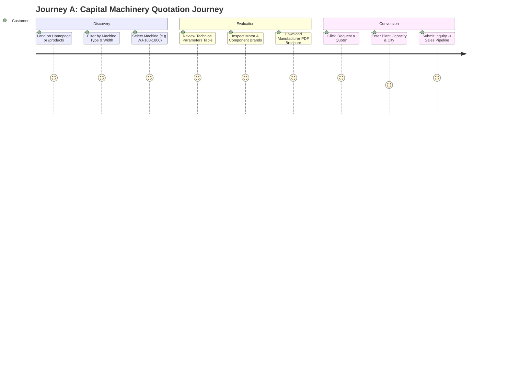
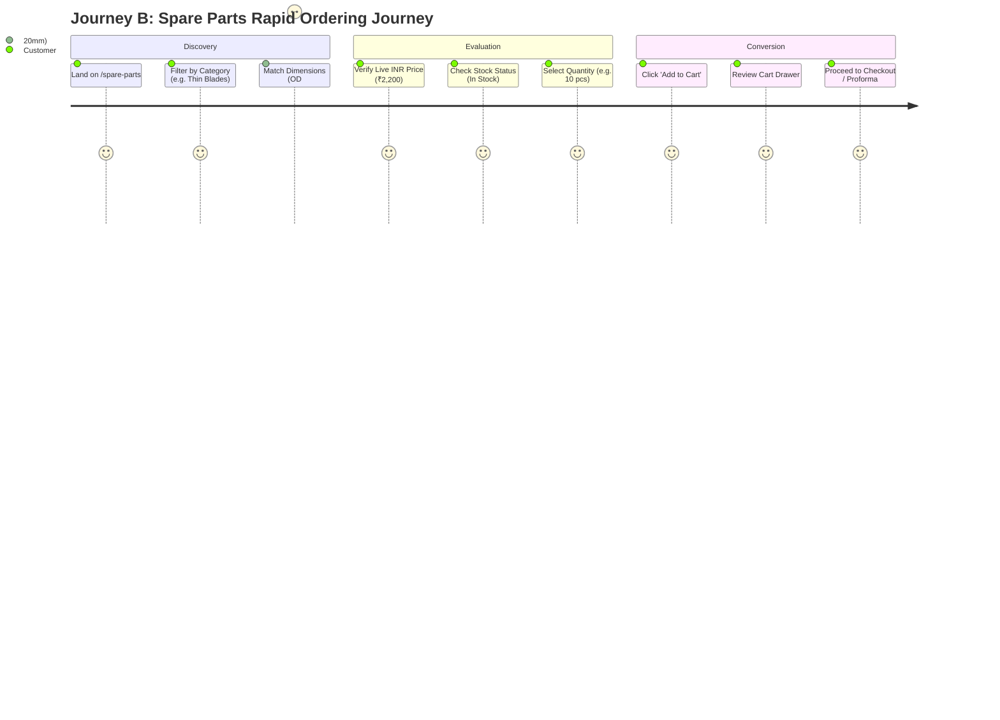

# NAGJAN UI/UX Architecture & User Journey Specification

**Brand Identity:** NAGJAN  
**Corporate Entity:** Mount Kailash Printpack Machines  
**Document Status:** Complete Architecture & Blueprint  

---

## 1. Information Architecture & Navigation Strategy

The NAGJAN digital platform serves two distinct B2B buyer profiles with different decision cycles:
1. **Capital Equipment Buyers:** High-investment corrugated plants and machines requiring technical verification, custom engineering options, and formal quote generation.
2. **Maintenance & Plant Engineers:** Urgent procurement of consumable wear parts and electrical/mechanical replacements with transparent INR pricing and fast checkout.

```
┌────────────────────────────────────────────────────────────────────────────────┐
│                           TOP INFORMATION & SUPPORT BAR                        │
│   Hotline: +91-7299 20 7800  |  sales@nagjan.com  |  Madhavaram Depot, Chennai │
├────────────────────────────────────────────────────────────────────────────────┤
│                                 MAIN HEADER                                    │
│  [NAGJAN Logo]   Home   About   Machinery ▾   Spare Parts ▾   Services   Contact│
│                                           [Search 🔍]  [Cart 🛒]  [Request Quote]│
└────────────────────────────────────────────────────────────────────────────────┘
```

### 1.1 Two-Level Header Architecture

#### Level 1: Top Utility & Emergency Support Bar
- **Background:** Primary Deep Navy (`#013074`) with high-contrast white/amber text.
- **Left Elements:**
  - Emergency Service Hotline: Direct click-to-call link `tel:+917299207800` (`+91-7299 20 7800`).
  - Sales Inquiry Desk: `mailto:sales@nagjan.com` (`sales@nagjan.com`).
- **Right Elements:**
  - Assembly & Spare Depot Location: *"Madhavaram Godown, Chennai — Ready Stock Spares"*.
  - Language / Currency Badge: `INR (₹) | English`.

#### Level 2: Primary Navigation & Interactive Tools
- **Background:** Crisp White (`#FFFFFF`) with 1px border separator (`#E2E8F0`), sticky on scroll.
- **Brand Identity:** Authentic NAGJAN logo (`/logo/nagjan-logo.png`) linking to `/`.
- **Primary Menu Items:**
  1. **Home (`/`)**
  2. **Machinery (`/products`) — With Dropdown / Mega-Menu:**
     - *Complete Corrugation Lines:* 2PLY Plant (WJ-100-1800).
     - *Single Facers:* SF-280, SF-10, SF-320S, SF-360S.
     - *Mill Roll Stands:* Hydraulic Shaftless (ZJ-V5B, 1400/1600mm), Electric Shaftless.
     - *Cut-Off & Stackers:* NC-1800 Rotary Cutter, JH-80 Mechanical, SZJ Stacker.
     - *Converting & Finishing:* Flexo Printer-Slotters, Auto Folder Gluers, Box Stitchers.
  3. **Spare Parts (`/spare-parts`) — With Category Dropdown:**
     - Anvil Covers (MaxDura), Thin Blades, Slitting Knives, Feeder Wheels, No-Crush Wheels, Belts, Cylinders, Sensors, Contactors.
  4. **About Us (`/about`)** (Heritage, 2010 founding, 240+ corrugators, Semi-Indian philosophy).
  5. **Services & Support (`/services`)** (Mr. D. Elumalai engineering team, erection, spares guarantee).
  6. **Contact (`/contact`)** (Perungudi Regd office, Madhavaram depot, direct phones).
- **Utility Actions:**
  - **Live Search Trigger (`Button`):** Opens instant command-palette search modal across machines and parts.
  - **Cart Drawer Trigger (`Button`):** Shows cart item count badge and opens slide-over cart drawer.
  - **Primary CTA Button:** *"Request a Quote"* (`#FEA81D` Amber) linking to quote modal or `/request-quote`.

### 1.2 Mobile Navigation Experience
- **Mobile Header:** NAGJAN Logo, Search icon, Cart badge, and accessible Hamburger toggle.
- **Slide-Out Sheet:**
  - Quick contact pill: Instant call button to `+91-7299 20 7800`.
  - Accordion dropdowns for Machinery and Spare Parts.
  - Clear links to About, Services, Contact, and Downloads.
  - Sticky bottom CTA: Full-width "Request a Quote" button.

---

## 2. Homepage Section Hierarchy & Blueprint

The homepage is structured to immediately establish industrial authority, present the dual catalog paths, communicate the unique engineering value proposition, and convert visitors into qualified sales inquiries.

```
┌───────────────────────────────────────────────────────────┐
│ 1. Hero Section: Precision Machinery & Dual Action Path    │
├───────────────────────────────────────────────────────────┤
│ 2. Trust & Capability Strip: Key Industrial Metrics       │
├───────────────────────────────────────────────────────────┤
│ 3. Flagship Machinery Showcase (2PLY, SF-280, Roll Stand) │
├───────────────────────────────────────────────────────────┤
│ 4. Quick Spare Parts Finder & Category Grid               │
├───────────────────────────────────────────────────────────┤
│ 5. The "Semi-Indian Machine" Engineering Advantage        │
├───────────────────────────────────────────────────────────┤
│ 6. Technical Support, Infrastructure & Madhavaram Godown  │
├───────────────────────────────────────────────────────────┤
│ 7. Interactive B2B Quotation Builder / Lead Generation    │
├───────────────────────────────────────────────────────────┤
│ 8. Comprehensive Two-Level Industrial Footer              │
└───────────────────────────────────────────────────────────┘
```

### 2.1 Section Specifications

#### Section 1: Hero Section
- **Visual:** High-resolution machinery photo (`/images/products/wj_100_1800_2ply_plant__july__2023_img_1.jpg`) with an industrial dark overlay.
- **Overline Badge:** `ENGINEERED IN CHENNAI SINCE 2010`
- **Headline (H1):** *High-Speed Corrugated Packaging Machinery & Precision Industrial Spares*
- **Supporting Paragraph:** *Mount Kailash Printpack Machines delivers heavy-duty corrugation lines and semi-Indian retrofits with Siemens/ABB drives, backed by 240+ plant installations and an extensive ready-stock spares inventory.*
- **Dual CTA Buttons:**
  - CTA 1 (Primary Amber): `Explore Machinery Lines` → Scrolls to or links to `/products`.
  - CTA 2 (Outline White): `Browse Spare Parts Catalog (INR)` → Links to `/spare-parts`.
- **Credibility Indicators:**
  - `240+` Corrugator Plants Delivered
  - `400+` Industrial Spares Ready to Dispatch
  - `15+` Years Manufacturing & Retrofitting Experience

#### Section 2: Trust & Capability Strip
- Full-width band with subtle grey background (`#F1F5F9`) displaying 4 core commitments:
  1. **Heavy-Duty Cast Iron Construction** (HT250 / 48CrMo / 50CrMo alloy steel).
  2. **Indian Electrical Upgrades** (Siemens, ABB, Crompton motors saving up to 30% power).
  3. **Zero-Downtime Spares Guarantee** (Mechanical and electrical parts stocked in Chennai).
  4. **Pan-India On-Site Engineering** (Installation, erection, and preventive maintenance).

#### Section 3: Flagship Machinery Showcase
- Interactive category tabs or carousel featuring key industrial lines:
  - **WJ-100-1800 2PLY Line:** 1800 mm width, 100 m/min speed, 50 KW connected power.
  - **SF-280 Single Facer:** $\phi 280\text{ mm}$ roll, ABB motor, negative pressure suction.
  - **ZJ-V5B Hydraulic Mill Roll Stand:** 3-ton capacity, $\phi 242\text{ mm}$ shaft, 7 Ocean hydraulics.
- Each card features: Extracted photo, 4-point technical parameter grid, component provenance badges, and a "Request Quote" CTA.

#### Section 4: Spare Parts Quick Finder
- Grid of 6 top consumable categories with live starting prices in INR:
  - *Anvil Covers (MaxDura)*
  - *Thin Blades & Slitting Knives (From ₹1,600)*
  - *Feeder & No-Crush Wheels*
  - *Pneumatics & Cylinders (From ₹1,650)*
  - *Sensors & Proximity Switches (From ₹1,450)*
  - *Timing Belts & Conveyor Belts (From ₹10,800)*
- Direct search bar: *"Search by part name, outer diameter (OD), inner diameter (ID), or SKU..."*

#### Section 5: The "Semi-Indian Machine" Engineering Advantage
- Two-column visual feature section:
  - **Left:** Highlighting why generic imported corrugators fail (fragile electronics, unavailable local spares, high power consumption).
  - **Right:** The NAGJAN Solution (Heavy Chinese mechanical castings paired with Indian Crompton/ABB motors, Siemens VFDs, and Schneider switchgear for durable, power-saving plant operation).

#### Section 6: Infrastructure & Service Network
- Details of the **Madhavaram Warehouse & Assembly Depot**:
  - Full machine pre-dispatch inspection and wrapping.
  - Dedicated service division headed by **Mr. D. Elumalai**.
  - Emergency spare parts dispatch within 24 hours.

#### Section 7: B2B Quotation Builder
- Clean, accessible multi-step inquiry form:
  - Step 1: Select Machine Type (2PLY Plant, Single Facer, Roll Stand, etc.)
  - Step 2: Desired Working Width (1400 mm, 1600 mm, 1800 mm, Custom)
  - Step 3: Flute Requirements (A, B, C, E)
  - Step 4: Contact & Factory Location (Company, Name, Phone, Email, City)
  - Submission triggers instant notification to `sales@nagjan.com`.

---

## 3. Product Architecture & User Journeys





### 3.1 Industrial Machinery Detail Page (`/products/[slug]`)
1. **Sticky Header Inset:** Machine Name, Model Number, and "Request Quote" button visible during scrolling.
2. **Media & Gallery:** Extracted high-res photographs with interactive thumbnail selector and zoom overlay.
3. **Primary Overview:** Working width, design speed, economic speed, power requirement badges.
4. **Interactive Tabbed Data System:**
   - **Tab 1: Technical Parameters:** Complete tabular data (working width, speed, steam pressure, power, installation space).
   - **Tab 2: Roll & Metallurgy Details:** Roll diameters ($\phi 280 / 292\text{ mm}$), material alloys (48CrMo, 50CrMo), surface hardness (HRC 50+), chrome plating, and flute geometry.
   - **Tab 3: Sub-Components & Brands:** Provenance breakdown (Siemens, ABB, Schneider, 7 Ocean, C&U, AirTac).
   - **Tab 4: Customer Site Utilities:** Boiler recommendations (1000 Kg/Hr @ 1.25 MPa), foundation drawings, electrical and piping requirements.
   - **Tab 5: Downloads:** One-click PDF brochure download linking to `/documents/*.pdf`.
5. **In-Page Quotation Form:** Fast lead submission pre-populated with current machine model.

### 3.2 Spare Part Detail Page (`/spare-parts/[slug]`)
1. **Product Header:** Part Name, SKU, Category breadcrumb.
2. **Product Imagery:** High-resolution part photograph on `#F8FAFC` background.
3. **Pricing & Stock:**
   - Live price: `₹2,200` *(Excl. 18% GST)*.
   - Stock badge: `In Stock — Ready to Dispatch from Chennai`.
4. **Dimensional Attributes Table:**
   - Outer Diameter (OD), Inner Diameter (ID), Thickness, Hole Count, Material Composition.
5. **Machine Compatibility List:** Explicit cross-reference tags (e.g., *Fits SF-280, SF-10, Standard Rotary Cutters*).
6. **Order Actions:**
   - Quantity stepper `[-] [ 1 ] [+]`
   - Primary Button: `Add to Cart`
   - Secondary Button: `Request Bulk Quote (50+ pcs)`

---

## 4. Reusable UI Component Architecture

The component hierarchy is structured to prevent duplication, guarantee type safety, and maintain the separation between presentation and state:

```
src/components/
├── layout/
│   ├── Header.tsx                 # Two-level header with top bar and primary nav
│   ├── Footer.tsx                 # Multi-column industrial footer
│   ├── Navigation.tsx             # Desktop navigation with mega-menu dropdowns
│   ├── MobileNavigation.tsx       # Accessible slide-out sheet navigation
│   └── Container.tsx              # Standard responsive layout container wrapper
│
├── home/
│   ├── HeroSection.tsx            # Main hero with background machinery image & CTAs
│   ├── TrustMetrics.tsx           # 240+ corrugators, 15+ years experience strip
│   ├── FlagshipShowcase.tsx       # Highlighted machinery cards
│   ├── SparePartsQuickFinder.tsx  # Categorized spare parts search & quick links
│   ├── SemiIndianAdvantage.tsx    # Power-saving Indian motors feature breakdown
│   ├── InfrastructureSection.tsx  # Madhavaram Godown and service team highlights
│   └── QuoteLeadSection.tsx       # Quick homepage quotation form
│
├── products/
│   ├── MachineryCard.tsx          # Card for CapEx industrial machines (quote workflow)
│   ├── SparePartCard.tsx          # Card for consumable parts (cart workflow)
│   ├── ProductGallery.tsx         # Image thumbnail switcher with modal zoom
│   ├── SpecsTable.tsx             # Tabular numerical parameter comparison grid
│   ├── ProvenanceBadges.tsx       # Component brand pills (Siemens, ABB, Schneider)
│   ├── ProductFilters.tsx         # Sidebar faceted filter controls
│   └── DownloadPDFButton.tsx      # Clean download action with file size indicator
│
├── common/
│   ├── SectionHeading.tsx         # Standardized H2/overtitle/description block
│   ├── CTAButton.tsx              # Specialized variant button (quote, primary, outline)
│   ├── Breadcrumb.tsx             # Accessible breadcrumb hierarchy navigation
│   ├── StockBadge.tsx             # In-stock / Made-to-order indicator
│   └── PriceDisplay.tsx           # Tabular formatted INR pricing with GST notes
│
└── cart/
    ├── CartDrawer.tsx             # Slide-over cart review drawer
    ├── CartItemRow.tsx            # Line item with quantity adjustments
    └── CartSummary.tsx            # Subtotal, tax estimation, and checkout trigger
```

